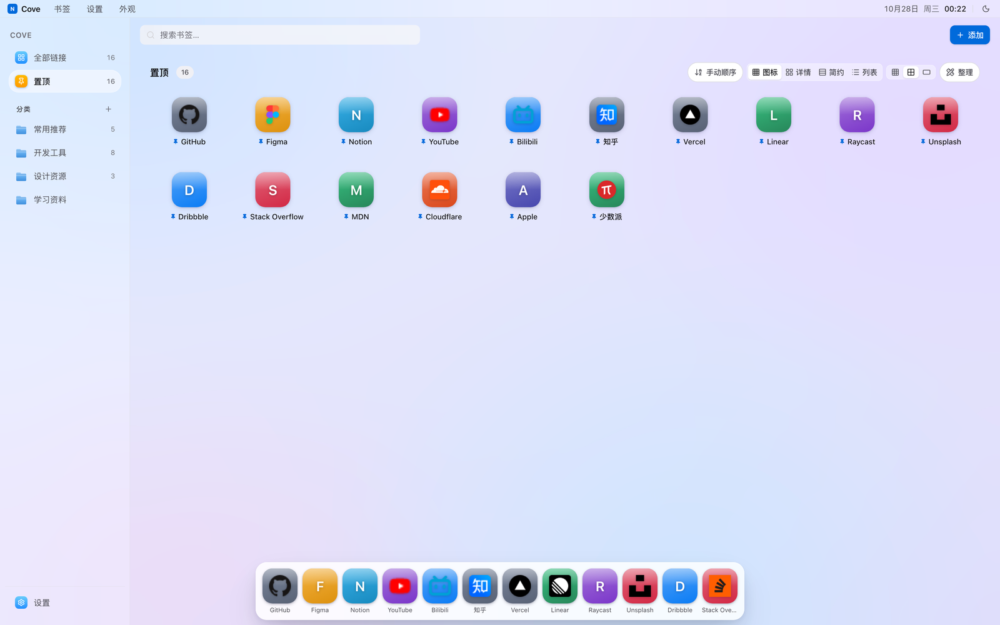
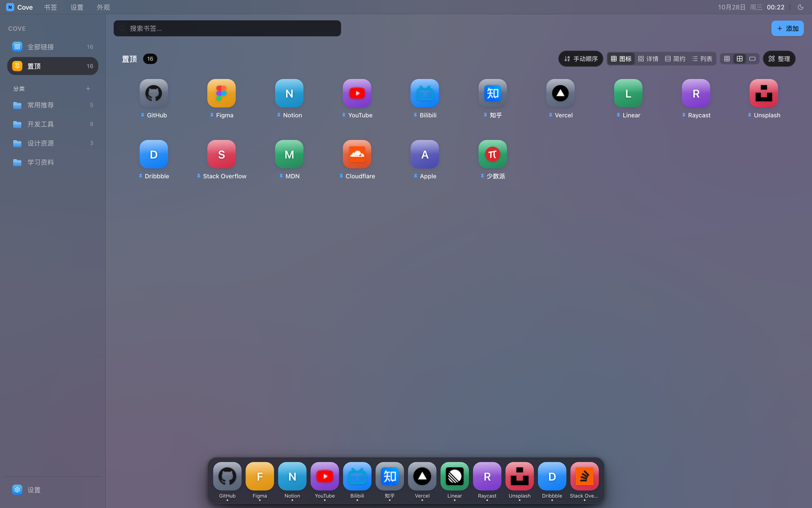
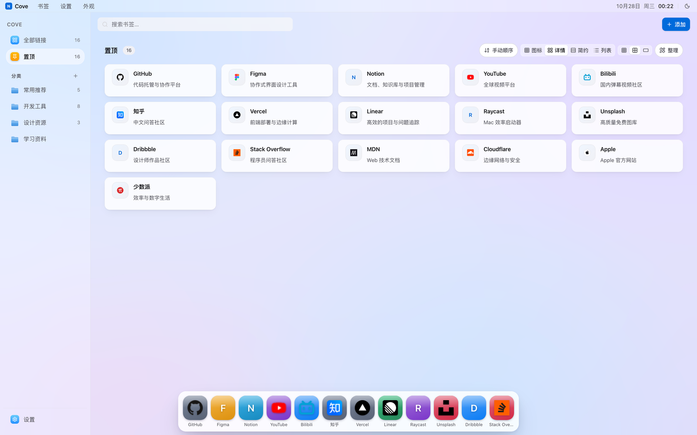
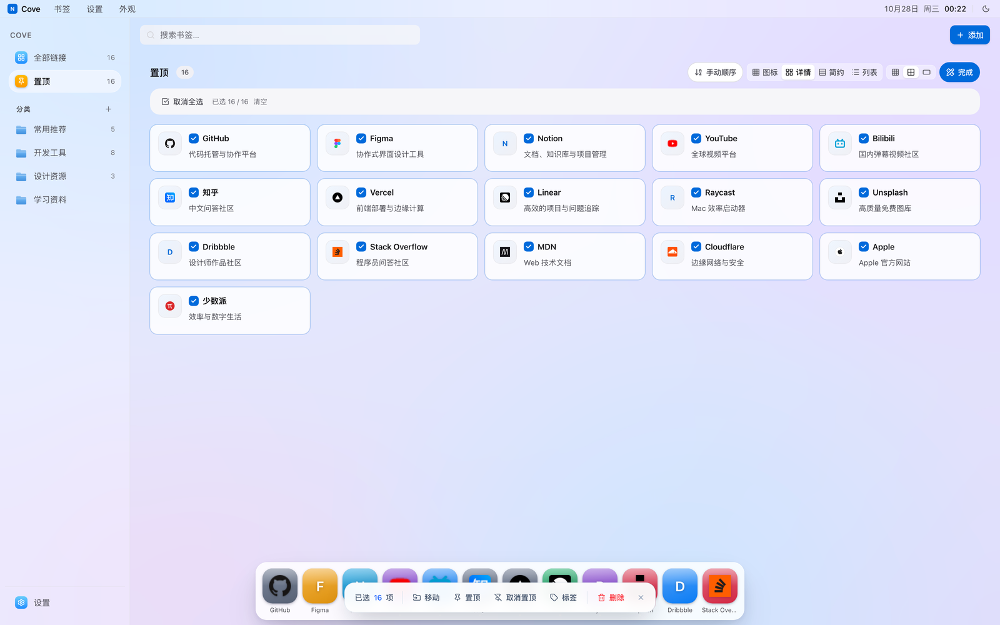
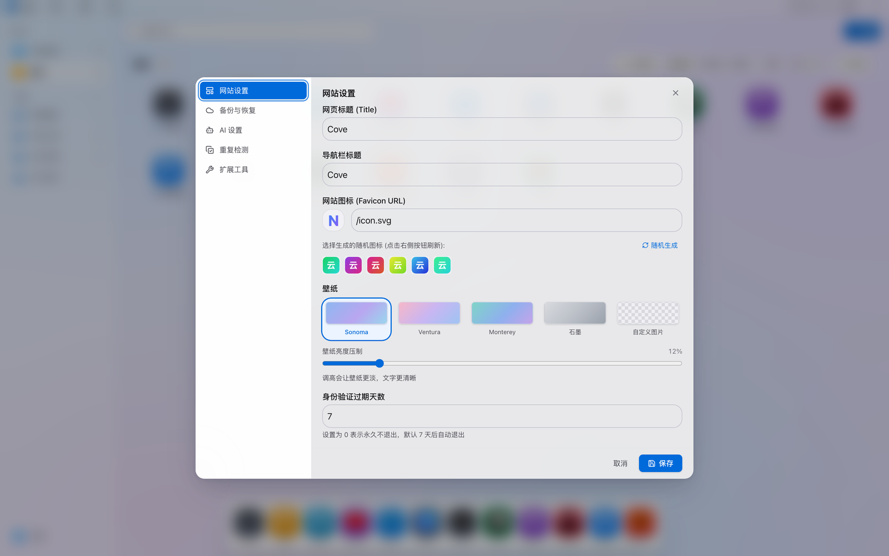

<div align="center">

# Cove

**把你的书签，做成一台 Mac 桌面的样子。**

一个自托管的书签导航站：Cloudflare 全栈部署、零服务器运维、边缘加速，
界面按 macOS 的材质语言重做——玻璃层、Dock、桌面图标，而不是又一个卡片列表。

[](https://developers.cloudflare.com/pages/)
[](https://react.dev/)
[](https://www.typescriptlang.org/)
[](https://tailwindcss.com/)
[](#工程实践)
[](LICENSE)

[快速开始](#快速开始) · [设计语言](#设计语言) · [架构](#架构) · [工程实践](#工程实践)

</div>

---



<div align="center">


</div>

## 为什么做这个

书签管理器大多止步于"能存能搜"。但一个人每天要打开几十次的东西，
**操作手感**和**视觉秩序**比功能列表更影响使用意愿。

Cove 的取舍很明确：

- **像桌面，不像后台**：Dock、图标网格、玻璃面板，抬手就知道点哪里
- **没有服务器要养**：Frontend + Functions + KV + R2 全在 Cloudflare，免费额度足够个人用
- **数据是你的**：JSON 一键导出，R2 固定对象备份，不绑定任何第三方账号
- **秘密不上客户端**：AI Key 只活在 Cloudflare Secrets，不进浏览器、不进 KV、不进导出文件

## 特性

### 界面

| | |
|---|---|
| **macOS 桌面形态** | 顶部菜单栏（日期 · 星期 · 时钟）、左侧文件夹栏、右侧桌面图标区、底部 Dock |
| **玻璃材质系统** | 壁纸 → 侧栏 vibrancy → 内容区 → 卡片，四层半透明 + `backdrop-filter`，层次由壁纸透出 |
| **四种卡片视图** | 图标 / 详情 / 简约 / 列表，随时切换 |
| **全局密度三档** | 紧凑 · 标准 · 宽松，一档同时缩放卡片与侧栏 |
| **壁纸自定义** | 4 套内置渐变 + 自定义图片 URL + 亮度压制滑杆 |
| **亮暗双主题** | 语义化 token 驱动，两套主题均通过 WCAG AA 对比度校验 |

### 交互

- **拖拽排序** — 手动模式按住卡片拖动；图标视图整卡即拖拽区，8px 阈值区分"单击打开"与"拖动"
- **拖拽到分类** — 卡片直接拖进左侧文件夹栏，完成移动
- **整理模式** — 多选、批量移动分类、批量置顶、批量加标签、批量删除
- **命令面板** — `⌘K` 唤起，键盘完成搜索与跳转
- **右键菜单** — 复制链接、二维码、编辑、置顶、删除
- **首屏自适应** — 按容器高度与实测格子高度计算首屏条数，宽屏不留下大片空白



### 数据

- 版本化同步：`baseVersion` 冲突检测，并发写入返回 `409` 而非静默覆盖
- 内容哈希比对：数据未变化时跳过 R2 上传
- 固定备份对象：只维护 `latest.json` 一份，不堆积时间戳历史
- JSON / HTML 双向导入导出

### AI

- 多家 OpenAI 兼容端点 + Gemini，统一走服务端 `/api/ai`
- 用途：自动生成描述、智能建议分类、文件夹重命名与结构整理
- **API Key 只从 Cloudflare Secrets 读取**，前端永远拿不到

## 快速开始

### 前置条件

- Node.js ≥ 20
- 一个 Cloudflare 账号（KV、R2、Pages 都在免费额度内）

### 本地开发

```bash
git clone https://github.com/Versior/cove.git
cd cove
npm install
npm run dev          # http://localhost:5173
```



### 质量门禁

```bash
npm run typecheck    # tsc --noEmit
npm test             # node:test，8 个用例
npm run build        # typecheck + vite build
```

### 部署到 Cloudflare Pages

**1. 创建存储资源**

```bash
# KV：存书签数据与配置
wrangler kv namespace create COVE_KV

# R2：存固定备份对象
wrangler r2 bucket create cove-backups
```

**2. 配置环境变量与 Secret**

在 Cloudflare Pages 项目 `Settings → Variables and Secrets` 中添加：

| 名称 | 类型 | 用途 |
|---|---|---|
| `PASSWORD` | Secret | 站点访问密码（必填） |
| `SESSION_SECRET` | Secret | 会话签名密钥（建议配置） |
| `OPENAI_API_KEY` | Secret | OpenAI 兼容端点的 Key（用 AI 时必填） |
| `GEMINI_API_KEY` | Secret | Google Gemini 的 Key（用 Gemini 时必填） |

> KV 与 R2 绑定在 `Settings → Functions → Bindings` 中配置，
> KV 绑定名 `COVE_KV`，R2 绑定名 `COVE_BACKUPS`（代码同时兼容旧名 `NAVIX_BACKUPS`）。

**3. 部署**

```bash
npm run build
wrangler pages deploy dist --project-name=cove
```

## 设计语言

Cove 的视觉不是"调了几次颜色"，而是从 macOS 的系统材质反向拆出来的三层结构。

### 材质分层

```
壁纸（固定视口）
  └─ 侧栏玻璃    backdrop-filter: blur(48px) saturate(180%)
      └─ 内容区   backdrop-filter: blur(32px) saturate(160%)
          └─ 卡片  backdrop-filter: blur(20px) saturate(170%)
```

玻璃必须**有东西可透**才成立。所以背景不是纯色，而是一层固定壁纸：
没有壁纸的玻璃只是一块灰板。

### Token 是语义的，不是色阶的

组件只引用语义名，亮暗与材质切换只改 `:root` / `.dark`：

```css
:root {
  --material-card:   hsl(0 0% 100% / 0.72);
  --text:            hsl(240 6% 10%);
  --text-soft:       hsl(240 5% 32%);
  --text-muted:      hsl(240 4% 44%);
  --accent:          hsl(211 100% 43%);
  --glass-edge:      hsl(0 0% 100% / 0.65);
  --shadow-card:     0 1px 1px hsl(240 20% 20% / .03),
                     0 2px 6px -1px hsl(240 20% 20% / .05),
                     0 8px 20px -6px hsl(240 20% 20% / .07);
}
```

三个反直觉的决定：

1. **背景带冷调，卡片纯白** — 纯白压纯白等于没有分层
2. **阴影三层叠加，不是单层** — 单层阴影是大面积灰雾，三层才有"托起"的物理感
3. **内圆角必须小于外圆角** — 32px 的盒子配 14px 圆角会被磨成歪圆

### 对比度是算出来的，不是看着调的

`--text-muted` 在浅色下收到 44%，在暗色下提到 58%——这两个数字不是手感，
是按 WCAG 公式对「卡片白底 / 内容区玻璃 / 选中态 accent-soft」三个背景分别求解得到的。

| 场景 | 浅色 | 暗色 |
|---|---|---|
| 正文 vs 卡片 | 17.7:1 | 14.2:1 |
| 次要文字 vs 卡片 | 8.3:1 | 8.2:1 |
| 弱化文字 vs 卡片 | 5.2:1 | 5.8:1 |
| 未达标项（AA 4.5:1） | **0** | **0** |

## 架构

```
┌─────────────────────────────────────────────────────────┐
│                     Cloudflare Edge                      │
│                                                          │
│  Pages (静态资源)        Pages Functions (边缘计算)        │
│  ┌────────────────┐     ┌─────────────────────────────┐  │
│  │ React 19 SPA   │     │ /api/auth     会话          │  │
│  │ Tailwind 4     │◄───►│ /api/storage  数据 + 配置    │  │
│  │ dnd-kit        │     │ /api/ai       代理 AI 请求   │  │
│  └────────────────┘     │ /api/favicon  图标代理       │  │
│                          │ /api/fetchtitle 标题抓取    │  │
│                          │ /api/link      扩展写入      │  │
│                          └──────────┬──────────────────┘  │
│                                     │                     │
│                    ┌────────────────┴───────────────┐     │
│                    ▼                                ▼     │
│              KV  (COVE_KV)                   R2 (COVE_BACKUPS) │
│         书签 / 分类 / 配置 / 图标缓存         cloudnav/latest.json │
└─────────────────────────────────────────────────────────┘
```

### 目录结构

```
├── functions/                 # Cloudflare Pages Functions
│   ├── _shared/
│   │   ├── auth.ts            # 会话、鉴权、CORS
│   │   ├── dataStore.ts       # 版本化读写、R2 固定备份、写入队列
│   │   └── hostGuard.ts       # SSRF 防护：拦内网 / 本地 / 重定向绕过
│   └── api/
│       ├── auth.ts            # 登录、登出
│       ├── storage.ts         # 数据与配置读写
│       ├── ai.ts              # AI 代理（Key 只在服务端）
│       ├── favicon.ts         # 图标代理（边缘抓取 + CDN 缓存）
│       ├── fetchtitle.ts      # 标题抓取
│       └── link.ts            # 浏览器扩展写入接口
├── components/                # 30 个 UI 组件
├── services/                  # 13 个纯逻辑模块
│   ├── density.ts             # 密度三档的尺寸映射
│   ├── fillScreen.ts          # 首屏自适应计算
│   ├── sorting.ts             # 五种排序 + 手动序
│   ├── wallpaper.ts           # 壁纸预设与自定义
│   └── dataNormalization.ts   # 数据规范化与迁移
├── tests/core.test.ts         # 8 个核心用例
└── index.css                  # 设计令牌 + 材质系统
```

### 关键设计

**单一部署单元。** 没有独立 Worker、没有第二个 Cloudflare 项目。
Functions 与静态资源同域，省掉跨域、省掉一处配置失误就全线挂掉的风险。

**边缘代抓图标。** 浏览器不直连 Google——项目在 Cloudflare 上，但用户在国内，
`gstatic` 会大面积失败。`/api/favicon` 由边缘按
`站点 /favicon.ico → 页面 <link rel="icon"> → DuckDuckGo` 顺序取图，
带 7 天 CDN 缓存，同一域名只回源一次。

**SSRF 防护。** `hostGuard.ts` 在**每次**外部抓取前校验主机：
拦截私网段、回环、云元数据地址，并禁止跟随重定向（否则公网地址可 302 到内网绕过校验）。

**数据一致性。** KV 是最终一致的，但 `dataStore.ts` 通过
写入队列 + `baseVersion` 比对，让并发写至少能返回 `409`，
并且**旧版本永远不会覆盖新版本**。

## 工程实践

### 测试

```bash
$ npm test

✔ normalizes legacy links without losing ordinary fields
✔ normalizes OpenAI-compatible endpoints and rejects webpage URLs
✔ drops retired categories together with their links
✔ persists versions, detects conflicts, and skips unchanged content
✔ writes only the fixed latest R2 object and skips the same hash
✔ does not let an older backup overwrite a newer stored version
✔ blocks private and loopback hosts while allowing public hosts
✔ reorders by order field and keeps the drag result visible

tests 8 · pass 8 · fail 0
```

覆盖的是**容易悄悄坏掉的地方**：数据迁移、冲突检测、R2 去重、版本回退、SSRF 白名单、拖拽序持久化。

### 类型

```
strict: true
noUnusedLocals · noUnusedParameters · noFallthroughCasesInSwitch
```

9533 行 TS/TSX，`tsc --noEmit` 零错误。

### 依赖

10 个生产依赖，且刻意保持克制：

| 依赖 | 用途 |
|---|---|
| `react` / `react-dom` 19 | UI |
| `@dnd-kit/*` | 拖拽排序与跨容器移动 |
| `lucide-react` | 图标 |
| `pinyin-pro` | 中文首字母搜索 |
| `qrcode` | 二维码生成 |
| `jszip` | 扩展打包 |
| `uuid` | ID 生成 |

没有 UI 框架、没有状态管理库、没有 HTTP 客户端——`fetch` 够用。

## Roadmap

- [ ] 书签快照与历史回滚
- [ ] 多用户与权限
- [ ] 标签体系重构（独立实体，支持重命名/合并）
- [ ] 主 chunk 拆包（当前 ~1.2MB）
- [ ] 移动端手势优化

## 已知限制

- **KV 最终一致** — 跨实例并发写无法做到原子事务，只能检测后返回 409
- **AI 需自行配置 Key** — 不提供公共额度，`OPENAI_API_KEY` / `GEMINI_API_KEY` 需在 Cloudflare 后台添加
- **图标依赖外部可达性** — 站点本身没有 favicon 时回落到彩色首字母，这是预期行为

## License

[MIT](LICENSE)

---

<div align="center">

**如果 Cove 让你少点了几次书签文件夹，给个 ⭐ 吧。**

</div>
